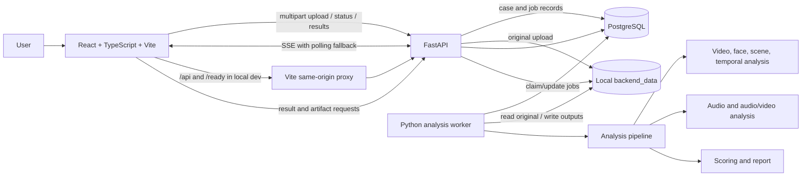

# DeepTrace System Guide

This guide describes the current DeepTrace application: its architecture, what each layer does, how an analysis moves through the system, how to monitor it, where its data lives, and a practical path to make confidence estimates more reliable.

## 1. What DeepTrace is

DeepTrace is a local video and audio evidence-analysis system. A user uploads a video in the React app. FastAPI records a case and a queued job in PostgreSQL. A separate Python worker analyzes the media, stores generated files on disk, and writes the structured result back to PostgreSQL. The React app then displays the case, evidence, and report.

The result is investigative evidence, not a definitive authenticity judgment. The combined evidence score is raw and uncalibrated unless a valid locally fitted calibration artifact is installed. No labeled calibration dataset or artifact is currently present in this repository.

## 2. Architecture at a glance



The Vite proxy is configured for local development and the current frontend tunnel. It forwards `/api` and `/ready` from port 5173 to the local API on port 8000, keeping browser requests same-origin. The Vite dev server is a development convenience, not a production reverse proxy.

## 3. Structured layers

| Layer | Main files | Responsibility |
| --- | --- | --- |
| Frontend | `frontend/src/App.tsx`, `frontend/src/api.ts`, `frontend/src/types.ts`, `frontend/src/styles.css` | Uploads a video, shows case history and job state, requests results, renders evidence, and links to reports/artifacts. Typed API calls live in `api.ts`; result and job shapes live in `types.ts`. |
| API | `backend/main.py`, `backend/schemas.py` | Validates requests, streams uploads to disk, creates case/job records, returns case/job/result data, serves Server-Sent Events (SSE), and serves reports/artifacts. Schemas define response shapes. |
| Persistence | `backend/repository.py`, `backend/config.py` | Uses Psycopg to create/read/update PostgreSQL `cases` and `jobs`; resolves configuration and local storage paths. Results are stored as JSONB. |
| Worker | `backend/worker.py` | Polls PostgreSQL, atomically claims queued jobs, calls the analysis pipeline, writes progress/result/failure state, and logs failures. Model instances are reused between jobs in each worker process. Numba's cache is placed under the writable data directory. |
| Analysis orchestration | `analysis_pipeline.py` | Coordinates media metadata, scene/frame extraction, face analysis, temporal scoring, audio analysis, synchronization checks, multimodal scoring, and report generation. It is kept independent of React and FastAPI. |
| Video analysis | `video_engine/` | Extracts video frames, detects/extracts faces, applies the Xception face classifier, and summarizes variation across frame predictions. PySceneDetect finds scene boundaries. |
| Audio analysis | `audio_engine/`, `audio_model/` | Extracts audio, divides it into windows, applies the AASIST-L audio model, scores windows, and compares audio/video duration. Lip-sync analysis is attempted separately. |
| Models and third-party code | `DeepfakeBench/`, `DeepfakeBench/training/weights/`, `audio_model/aasist/` | Supplies the Xception model implementation/checkpoint and AASIST-L model implementation/checkpoint. Checkpoint files are excluded from Git and must exist in the local environment. |
| Database service | `compose.postgres.yaml` | Runs PostgreSQL in Docker for local development and keeps its data in a named Docker volume. |

### Current state held in PostgreSQL

- `cases`: case ID, original display filename, SHA-256, byte size, creation time, upload path, and JSONB result.
- `jobs`: job ID, case ID, status, current stage, progress, timestamps, safe error fields, and analysis options such as frame interval.

Possible job statuses are `queued`, `running`, `succeeded`, and `failed`. The worker uses PostgreSQL row locking with `SKIP LOCKED`, allowing more than one worker to claim different jobs.

## 4. What happens during an analysis

1. The frontend posts the video to `POST /api/v1/cases` as multipart form data. It sends a `frame_interval` of `0.25`, `0.5`, `1.0`, or `2.0` seconds.
2. The API checks the file extension and size, streams it to the upload directory, and computes a SHA-256 hash as it writes. The default upload limit is 2 GiB; `DEEPTRACE_MAX_UPLOAD_BYTES` can override it.
3. The API inserts the case and a `queued` job in PostgreSQL and returns their IDs with HTTP `202`.
4. The worker polls for queued jobs. It claims one, changes it to `running`, and calls `analyze_video_file(...)` with the case-specific input and output directory.
5. The pipeline probes metadata and hash, records SHA-256 identifiers for available model checkpoints, detects scenes, extracts sampled frames, detects faces, runs the Xception classifier on face crops, summarizes frame-level scores, extracts audio when present, runs AASIST-L on audio windows, evaluates audio/video duration alignment when both tracks exist, and generates the structured result and text report. Default compute limits cap inference at 600 sampled video frames and 300 audio windows; `.env` can adjust them.
6. Before report generation, the pipeline checks for `cases/score_calibration.json`. When present, it applies the saved isotonic mapping to the combined raw score and includes its held-out metrics in the result/report. Without that artifact, the calibrated score is absent and the UI shows only the raw score.
7. The worker stores the result in the case's JSONB field and marks the job `succeeded`. On an exception, it logs a traceback and marks the job `failed` with a safe API-facing message.
8. The frontend receives status events over SSE. If SSE is interrupted, it polls the job endpoint. On success, it loads the result, thumbnails, and report link.

### Progress stages

The pipeline currently reports broad stage updates, not progress for every frame or model inference. The displayed number can therefore stay still while a stage is working.

| Stage | Approximate reported progress | Work being done |
| --- | ---: | --- |
| `provenance` | 8% | Hash and media metadata. |
| `scene_detection` | 12% | Find scene boundaries. |
| `frame_extraction` | 18% | Save the sampled frames used for visual inference. |
| `face_analysis` | 25% | Detect faces and run the visual classifier on face crops. This can take the longest on CPU or with dense sampling. |
| `temporal_analysis` | 52% | Summarize variation across frame predictions. |
| `audio_analysis` | 62% | Extract and score audio windows. |
| `av_analysis` | 82% | Compare track durations and run the separate lip-sync check when available. |
| `report_generation` | 94% | Assemble findings and report. |
| `complete` | 100% | Persist the result and finish the job. |

These values mark stage starts/completions rather than a smooth estimate of time remaining. Jobs left `running` for more than six hours are requeued when a worker starts; the current worker does not heartbeat or automatically retry recent failed jobs.

For long videos, the analysis pipeline increases the effective frame interval when needed to stay within the configured frame budget. Audio inference likewise increases its window step to stay within its window budget, retaining samples across the full recording. The result and report state when either limit reduced sampling. Scene detection and media decoding still read the source video, so long or high-resolution files can continue to take time even with bounded model inference.

Each worker process keeps loaded Xception and AASIST-L models in memory for subsequent jobs. The report records checkpoint SHA-256 hashes so a reviewer can identify the exact model files used. Restart the worker after replacing checkpoints to ensure it loads the new weights.

## 5. How the analysis scores work today

### Visual signal

The Xception classifier analyzes detected face crops and produces a softmax `fake_probability` per crop. The temporal analyzer averages face probabilities per frame, then averages frame probabilities to produce `mean_fake_probability` for the video signal.

### Audio signal

The AASIST-L model scores overlapping four-second audio windows with a two-second step. The audio evidence score is computed as:

```text
0.50 × average spoof probability
+ 0.20 × maximum spoof probability
+ 0.30 × percentage of windows classified as spoof
```

### Combined evidence score and verdict

The current multimodal score is:

```text
0.50 × video score + 0.50 × audio evidence score
```

The verdict thresholds are `>= 0.75` high, `>= 0.55` moderate, `>= 0.40` low, and below `0.40` very low AI/deepfake evidence. The source code explicitly treats temporal consistency and A/V synchronization as supporting indicators rather than adding them to this primary weighted score.

The displayed temporal consistency is `1 - standard_deviation` of frame fake scores, clamped at zero. This indicates how similar the sampled predictions are; it does not independently establish whether the clip is fake. Track alignment is based primarily on the difference between audio and video duration. A compatible SyncNet model/checkpoint is not configured, so detailed lip-sync evidence can be unavailable. The rule-based animation/CGI appearance heuristic is a side finding and is not part of the combined score.

These scores combine model outputs and hand-selected weights/thresholds. When both modalities are available, video and audio contribute equally. If one modality is unavailable, the remaining model signal is used alone and the interface labels the result as single-modality; if neither is usable, no combined score is shown. The values are **not calibrated probabilities**. For example, `75%` means a current evidence score of 0.75, not that there is a validated 75% chance of manipulation.

## 6. How to run and monitor the services

Start PostgreSQL, API, worker, and frontend in separate terminals as described in [README.md](README.md). The API and worker should use the same environment and root `.env`; the worker also needs the inference packages and model checkpoints.

### PostgreSQL / Docker

From the repository root:

```powershell
docker compose -f compose.postgres.yaml ps
docker compose -f compose.postgres.yaml logs -f postgres
```

The Docker health check uses `pg_isready`. API readiness also checks the database:

```powershell
Invoke-RestMethod http://127.0.0.1:8000/health
Invoke-RestMethod http://127.0.0.1:8000/ready
```

`/health` means the API process responds. `/ready` also means PostgreSQL is reachable. API documentation is at `http://127.0.0.1:8000/docs`.

### API / case / job status

```powershell
Invoke-RestMethod 'http://127.0.0.1:8000/api/v1/cases?limit=20&offset=0'
Invoke-RestMethod 'http://127.0.0.1:8000/api/v1/jobs/<job_id>'
Invoke-RestMethod 'http://127.0.0.1:8000/api/v1/cases/<case_id>'
Invoke-RestMethod 'http://127.0.0.1:8000/api/v1/cases/<case_id>/artifacts'
```

For live job events, use:

```powershell
curl.exe -N 'http://127.0.0.1:8000/api/v1/jobs/<job_id>/events'
```

The frontend displays the current status in case history and the selected job panel. If it is slow, inspect the worker terminal: it reports when it starts, logs scene-detection output, reports completions, and prints a traceback on failure.

### Worker

The worker runs in the terminal where `python -m backend.worker` was started. A healthy idle worker logs `DeepTrace worker started` and waits between database polls. To check whether a particular job is active, query the job endpoint above. The API progress stage is coarse, so also watch for worker log activity and newly created files in the case artifact directory.

### Frontend and current tunnel

- Local development URL: `http://127.0.0.1:5173/`.
- API URL: `http://127.0.0.1:8000/`.
- The current Dev Tunnel forwards port 5173. Vite proxies `/api` and `/ready` to the local API, so case history and artifacts are loaded through the same tunneled origin.
- Check the Vite terminal for startup and proxy errors. If port 5173 is already in use, the frontend may already be running.
- The tunnel is for development. It depends on the Vite server, API, and worker remaining active on the host.

## 7. Where files and records are stored

The default is relative to the repository root when services are launched from that root. `DEEPTRACE_DATA_DIR` changes the base directory.

| Data | Default location | Notes |
| --- | --- | --- |
| Original uploaded videos | `backend_data/uploads/<case_id>.<extension>` | The filename shown in the UI is stored as metadata; the saved upload uses an opaque case ID. |
| Video frames and face crops | `backend_data/artifacts/<case_id>/cases/<first-16-chars-of-SHA256>/frames/` and `.../faces/` | Generated during visual analysis. |
| Extracted audio | `backend_data/artifacts/<case_id>/cases/<first-16-chars-of-SHA256>/audio/audio.wav` | Intermediate analysis artifact. |
| Numba cache | `backend_data/numba_cache/` | Writable cache set by `backend/worker.py`. |
| PostgreSQL data | Docker volume `deeptrace_postgres_data` (Compose may prefix it with the project name) | Persists independently of the container. `docker compose down` keeps it; `docker compose down -v` removes it. |
| Legacy SQLite database | `backend_data/deeptrace.sqlite3` if present | Source for optional migration. Migration leaves the SQLite file in place. |
| Model checkpoints | `DeepfakeBench/training/weights/xception_best.pth`, `audio_model/aasist/AASIST-L.pth` | Required locally; excluded from Git and not downloaded by the backend requirements file. |

PostgreSQL holds metadata and the JSONB analysis result; the uploaded video and generated media remain on local disk. There is currently no automatic media retention/deletion process. Back up the PostgreSQL volume and `backend_data` together if you need to preserve cases.

The root `.env` controls the database URL, data directory, upload limit, and CORS origins. `frontend/.env` controls `VITE_API_BASE_URL`; leave it blank for the local Vite proxy, or set an API origin when the frontend and API are hosted separately. Never commit `.env` or private evidence files.

## 8. A feature to make confidence more trustworthy

Yes. The best first feature is a **calibrated confidence and reliability panel**, supported by a labeled validation set and quality/uncertainty flags. The goal should be to make confidence more accurate and useful, not to make the number higher.

### Why this is the right first improvement

1. The current Xception and AASIST outputs are model scores. Their softmax values are not known to match real-world success rates.
2. When both modalities are available, the final score combines video and audio with fixed 50/50 weights, even when one modality may have weak evidence. Missing modalities are now omitted rather than treated as a zero score.
3. A single threshold turns the combined score into a verdict without measuring calibration, false-positive cost, or performance on unseen generators/codecs.
4. Published work shows that modern neural networks can be miscalibrated and that post-hoc temperature scaling can improve calibration on a held-out validation set. Calibration alone does not fix model errors or dataset/domain shift. Deepfake detection benchmarks also emphasize standardized evaluation across datasets and manipulation types. [Guo et al., *On Calibration of Modern Neural Networks*](https://arxiv.org/abs/1706.04599), [DeepfakeBench, NeurIPS 2023](https://papers.nips.cc/paper_files/paper/2023/hash/0e735e4b4f07de483cbe250130992726-Abstract-Datasets_and_Benchmarks.html), [DF40, NeurIPS 2024](https://papers.nips.cc/paper_files/paper/2024/hash/34239f60eca7ce9bee5280aaf81362d8-Abstract-Datasets_and_Benchmarks_Track.html).

### Suggested design

1. **Build a labeled evaluation set.** Include real and manipulated video/audio, label the manipulation type, and keep near-duplicate source videos in the same split. Reserve a validation set for calibrator fitting and a separate test set for final metrics. Add tests for unseen generators, compression, low resolution, no-face clips, no-audio clips, and audio/video mismatch.
2. **Measure before changing the score.** Report AUROC, precision/recall, false-positive rate at useful operating points, Brier score, and expected calibration error. Break results out by modality and media-quality group. Evaluate on held-out sources/manipulation types.
3. **Calibrate model outputs.** Fit temperature scaling (or another selected calibrator) on validation predictions for the visual model and audio model. Version the calibrator with the model/checkpoint and dataset snapshot. Do not fit it on the final test set or production cases.
4. **Revisit multimodal fusion.** Learn or validate the fusion weights from held-out labeled cases instead of assuming video/audio should always contribute equally. Preserve missing-modality behavior and show which signals were actually available.
5. **Add confidence bands and an abstain state.** Show calibrated score plus a quality/coverage indicator. Mark a case “inconclusive” when too few faces/frames are available, audio is absent/too short, modalities disagree, or the input is outside tested conditions. Do not force every clip into real/fake.
6. **Track model and calibration versions.** Store model/checkpoint hashes, pipeline version, frame interval, audio window settings, and calibrator version with each result so a later reviewer can reproduce the score.

### What the user should see

- Current raw evidence score, explicitly labeled as uncalibrated until evaluation supports probability wording.
- A calibrated estimate only when a local calibration artifact is installed; avoid calling it a likelihood until the calibration and performance claims are supported by representative, independent evaluations.
- Video and audio scores separately, with a “not available” state when a modality could not be analyzed.
- Evidence coverage: sampled frame count, detected face count, audio duration/window count, quality warnings, and modality disagreement.
- “Inconclusive / needs human review” when data quality or uncertainty is too high.

This feature can improve **confidence reliability and interpretation**. It cannot guarantee a higher detection accuracy. A stronger model or new data may improve accuracy, but that must be demonstrated on held-out, representative data rather than inferred from a larger displayed percentage.

## 9. Calibration: current implementation and setup

DeepTrace now has an offline calibration workflow. It fits an isotonic regression mapping from the combined raw evidence score to labels, evaluates the mapping on held-out rows, and saves the mapping for use on subsequently analyzed cases. This improves score reliability only when the labeled data is representative of the data being analyzed. It does not independently establish authenticity.

### Required labeled CSV

Create a CSV with these required columns:

| Column | Values | Purpose |
| --- | --- | --- |
| `score` | Number from 0 to 1 | The raw `multimodal_result.primary_score` produced by the same DeepTrace pipeline/model version. |
| `label` | `0` real, `1` manipulated | Ground-truth label. |
| `split` | `train` or `test` / `holdout` / `validation` | `train` rows fit the mapping; held-out rows measure it. At least 10 rows and both labels are required in each side. |
| `dataset` (optional) | Dataset/source identifier | Produces held-out metrics by dataset. |
| `manipulation_type` (optional) | Manipulation family, e.g. face swap or reenactment | Produces held-out metrics by manipulation type. Real examples can use `real` or `none`. |

Use predictions generated by this pipeline on labeled examples. Keep near-duplicate source videos and derived manipulations in a single split to prevent leakage. Do not fit on production user cases or use test labels to tune the model. Subgroups with fewer than 10 held-out examples are omitted; subgroup AUROC is omitted if that subgroup has only one label.

To create the predictions CSV directly from labeled videos, prepare a manifest with columns `video_path,label,split` and optional `dataset,manipulation_type`. Relative paths are resolved from the manifest folder. Labels are `0` for real and `1` for manipulated. The evaluator hashes each input, refuses duplicate media in multiple splits, writes errors to `analysis_error`, and leaves the combined `score` empty when either audio or video is unavailable. For example:

```powershell
python -m backend.evaluate_dataset path\to\labeled_manifest.csv --output cases\labeled_predictions.csv
python -m backend.calibrate cases\labeled_predictions.csv
```

Review the output CSV before fitting: exclude failed rows, verify the split and subgroup labels, and confirm the paired modality coverage matches the intended deployment. The evaluator does not add cases to the app database and does not ship with a labeled dataset.

Run from the repository root with the same Python environment used for analysis:

```powershell
python -m backend.calibrate path\to\labeled_scores.csv
```

The command prints held-out Brier score, expected calibration error, and ROC AUC, and writes `cases/score_calibration.json`. The artifact records the source CSV SHA-256, row counts, overall held-out metrics, and available dataset/manipulation breakdowns. The path can be changed with `--output`, but runtime analysis loads only the default `cases/score_calibration.json` location. Re-run calibration when model checkpoints, score fusion, or evaluation population changes. Existing completed cases are not recalculated; only new analyses use the artifact.

The React result view and downloadable text report show a calibrated estimate only when the default artifact exists and both video and audio model signals are available. They also show the held-out row count and a similarity caveat. The UI labels the underlying blend as a raw evidence score. No calibrated score is currently active because no real labeled calibration CSV or artifact was found in the repository. The API does not offer a calibration upload endpoint; fitting is a local operator command, which avoids exposing a global calibration-file write route on the unauthenticated development app.

These metrics describe the supplied sample, not a guarantee of real-world error rates. A single global calibrator can conceal poor performance on a particular dataset or manipulation type, which is why subgroup results and continued held-out evaluation matter.

## 10. Current operating limitations

The development app has no authentication or per-user case authorization, so anyone with access to a public development tunnel may reach upload, case, result, report, and artifact routes. Uploads, results, and artifacts live on local disk without shared object storage or automatic retention/deletion. The system also lacks a production queue, cancellation, worker heartbeat, and ordinary failure retry policy.

`requirements-backend.txt` installs API/database packages only; the full inference dependencies and model checkpoints must be provisioned separately. No labeled calibration set or active calibration artifact is included, so cross-dataset accuracy and calibration have not been established. Detailed SyncNet lip-sync analysis is unavailable until compatible model code and checkpoints are configured.

For local start-up commands and first-time setup, see [README.md](README.md). For route-level API details, see [BACKEND.md](BACKEND.md).
